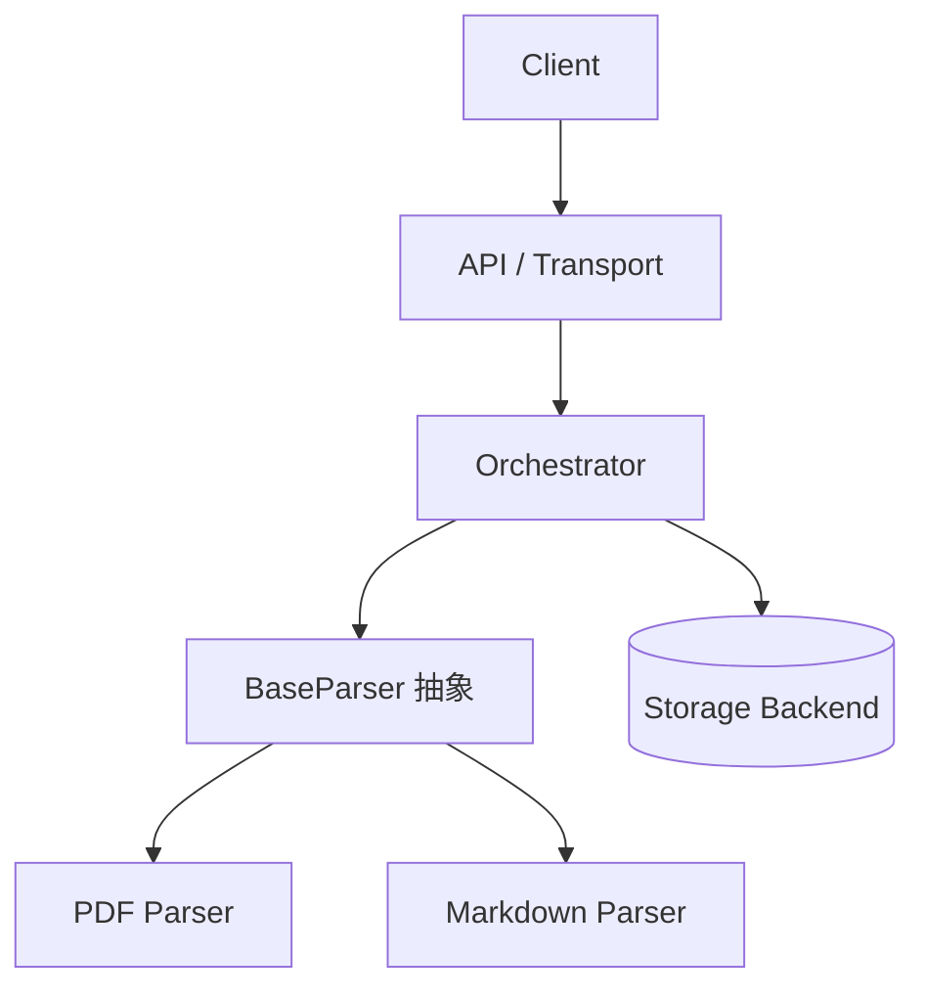

# 第 3 章：架构设计与核心方案

目标：用全局视角回答"我们究竟打算怎么做"，让评审者看懂拓扑、边界与选型。

## 四个维度

1. **整体拓扑与组件划分**：一张图（Mermaid C4/组件图）；标注新增、改造、保持不变。
2. **核心领域模型与解耦**：核心实体（如 `Document`、`Parser`、`Checkpoint`）的职责边界；依赖倒置或统一接口。
3. **关键数据流与时序**：核心链路怎么走；异常时的兜底流向。
4. **关键技术决策**：为什么选这个协议/存储/并发模型；详细对比放第 7 章。

## 模板

```markdown
## 3. 架构设计与核心方案

### 3.1 总体架构


> 核心原则：职责单一，解析算子与持久化存储解耦。

### 3.2 核心模块职责
* **API / Transport**：连接、鉴权、请求入口。
* **Pipeline / Orchestrator**：任务编排、异步调度、Checkpoint。
* **Parser 算子层**：统一接口，插件化实现。
* **Storage Backend**：仓储模式，透明切换。

### 3.3 核心数据流转
1. 客户端提交任务，API 生成 Trace ID 并入队。
2. Pipeline 拉取任务，加载对应 Parser。
3. 每个关键节点写入 Checkpoint。
4. 结构化 `Document` 经 Storage 落库。
```

## 避坑

- 不要在这里贴几百行类代码或 SQL；细节留第 4 章。
- 重点写"变与不变"：新引入什么、复用什么、哪些旧模块会受影响。
- 图里不写 Spec 编号。

## 检查

- 有一张能看懂的拓扑图。
- 每个模块有一句职责，不是目录清单。
- 写清了新增/改造/不变。
- 关键选型有理由，详细对比指向第 7 章。
