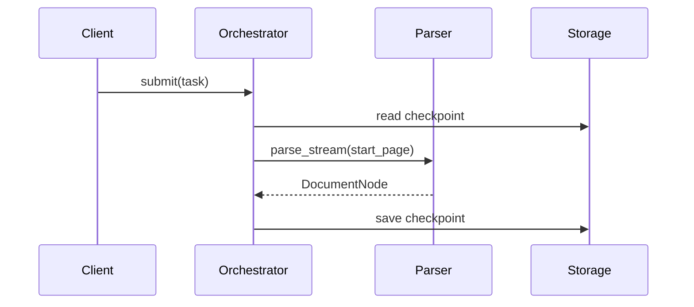

# 第 4 章：详细设计

目标：精确到每块积木的尺寸、接口、数据结构和异常边界，让开发不必反复确认。

## 四个板块

1. **数据模型与存储**：核心实体、DTO、表结构/集合；字段类型、必填、默认值、校验、索引。
2. **接口与协议**：REST/WebSocket/内部抽象类；方法、路径、请求/响应、状态码、事件流。
3. **核心流程与时序**：复杂分支用 Mermaid 时序图；正常路径 + 异步/异常路径。
4. **异常处理与容错**：异常层级、统一错误码、重试、降级、兜底。

允许写抽象类、接口、数据契约；禁止写具体实现代码。

## 模板

```markdown
## 4. 详细设计

### 4.1 数据模型
| 实体 | 字段 | 类型 | 必填 | 说明 |
| --- | --- | --- | --- | --- |
| DocumentNode | node_id | string | 是 | 节点唯一 ID |
| DocumentNode | page_index | int | 是 | 页码 |
| ParseTask | status | enum | 是 | pending / processing / completed / failed |

### 4.2 接口与协议
- `POST /tasks`：创建解析任务；请求 `{file_path}`；响应 `{task_id}`；`409` 重复任务。
- WebSocket `subscribe`：`{action, task_id, resume_from_page}`；事件 `node_emitted`。
- 内部 `BaseParser.parse_stream(file_path, start_page) -> AsyncGenerator[DocumentNode]`。

### 4.3 核心时序


### 4.4 异常与错误码
| 错误码 | 触发场景 | 处理策略 |
| --- | --- | --- |
| `ERR_DOC_ENCRYPTED` | PDF 带密码 | 终止，释放句柄，返回提示 |
| `ERR_PARSER_TIMEOUT` | 单页 > 30s | 记录警告，最多重试 2 次 |
| `ERR_CHECKPOINT_IO` | Checkpoint 写入失败 | 降级内存暂存，告警 |
```

## 避坑

- 术语、类名、字段名必须和实现一致，避免"文档一套、代码一套"。
- 边界条件必须有说明：空文件、超大文件、并发冲垮连接池。
- 错误码不能只写"抛出异常"；写清捕获什么、是否记录、返回什么。

## 检查

- 数据模型有字段类型、必填、校验。
- 接口有请求/响应/状态码或方法签名。
- 复杂流程有时序图。
- 每个错误码有触发场景与处理策略。
