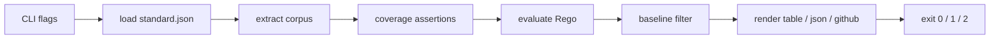
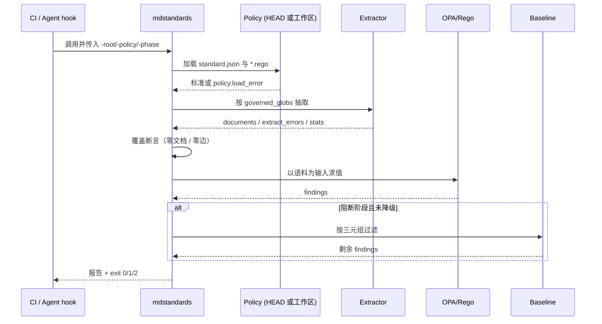

# MDStandardsKit v1 元数据闸门 技术方案

| 字段 | 内容 |
| --- | --- |
| 标题 | MDStandardsKit v1 元数据闸门 技术方案 |
| 主笔 | alang |
| 评审人 | 独立 agent（用户 alang 委托代审）；v1 无独立下游负责人 |
| 创建日期 | 2026-10-30 |
| 目标版本 | v1 |
| 关联资源 | [架构](../../architecture/mdstandards-architecture.md) |

## 1. 背景与上下文

### 1.1 系统现状

仓库中的技术文档主要由 Agent 生成。每篇文档在 frontmatter 里声明 `type`、`status`、`owner` 与 `depends_on`，下游的 Agent 与评审者据此判断某篇文档能否作为开发依据。

当前的核心流程如下：

1. Agent 生成或修改一篇 Spec，并在 `depends_on` 中写下一个或多个文档路径。
2. 另一名 Agent 读取该 Spec，把 `depends_on` 指向的架构文档及其 `status` 当作输入。
3. 文档进入评审、检索与下游生成流程。

这条流程上没有任何自动校验：没有工具检查目标文档是否存在，也没有工具检查目标文档是否已批准。仓库偶尔做人工抽查，但 Agent 写完即进入下游，抽查既不覆盖全部产物，也不发生在正确的时点。

### 1.2 核心技术痛点

失败链如下：

1. 一份 Spec 声明 `depends_on` 指向某篇架构文档。
2. Agent 把这篇架构文档及其状态当作开发依据。
3. 没有任何东西验证它存在，也没有东西验证它已被批准。
4. 构建全绿、页面都在、检索正常，代码却照着过期或未批准的架构写完了。

证据：截至 2026-11-01，在 `/Users/alang/Workspace`（排除本仓库、`.claude` 技能目录与 `crawlers/` 抓取语料）的 411 篇 Markdown 中，只有 1 篇声明了 `depends_on`，且为空数组；真实语料主要用表格维护依赖（`meta_standards`、`spec_upstream_refs`）。因此，以 phase 1 直接对既有仓库运行 v1 会因“零依赖边”退出 2；这是 fail-closed 的设计行为，不是缺陷。

缺口：本次没有拿到一次具体事故的时间、涉及文件数与投入工时。这一点记入附录 A。

### 1.3 重构/设计动机

在文档进入下游之前，用机器闸门检查**文档引用图**的完整性，而不是单个文件的格式。v1 只做两条规则：引用存在、目标状态可依赖。闸门必须在 CI 合并时和 Agent 写完自检时都能执行。

触发点：office-hours 设计已于 2026-10-30 批准，v1 进入实现与接入阶段；如果此时仍只靠人工抽查，引用图缺陷会在接入后继续静默进入下游。

### 1.4 非目标

不把闸门做出来的后果见 1.2：失败继续静默，代码继续照着过期或未批准的架构写。本次明确不做或延后：

- 必填字段、status 枚举、状态流转、复审有效期、审批来源校验（Deferred to Phase 2）。
- 循环引用检测（Deferred to Phase 2；与 PDS-STD-004 §8.5.6 的偏离见第 7 章）。
- pre-commit 执行点（本次不做）。
- 包管理器分发（本次不做）。
- 多仓库语料合并（Deferred to Phase 2）。

## 2. 目标与非目标

### 2.1 目标

- **G1 引用存在**：每条 `depends_on` 的目标必须在受管语料中；缺失产出 `refs.missing_target`。验收：`TestMissingTargetBlocks`。
- **G2 状态可依赖**：目标 `status` 必须逐字等于 `dependable_statuses` 中的某一项；缺失或大小写不符同样违规。验收：`TestNonDependableStatusBlocks`、`TestLowercaseStatusIsNotDependable`。
- **G3 Fail-closed**：零受管文档在任一 phase 都退出 2；零解析文档与零依赖边在 phase ≥ 1 退出 2，策略降级不绕过这些覆盖断言；解析错误在 phase ≥ 1 且未触发策略降级时退出 2，触发降级时只报告并退出 0，不得静默通过。验收：`TestZeroGovernedDocumentsFailsClosed`、`TestZeroEdgesFailsClosed`、`TestExtractErrorFailsClosedInPhase1`（降级路径未覆盖）。
- **G4 分阶段**：phase 0 不因违规或解析错误阻断（工具级错误仍退出 2）；phase 1 对基线外的新违规退出 1；基线按 `(rule, document, target)` 精确匹配。验收：`TestPhase0NeverBlocks`、`TestBaselineSuppressesKnownViolation`、`TestBaselineDoesNotSuppressRenamedTarget`。
- **G5 稳定输出**：JSON 含 `schema_version`、`findings`、`extract_errors`、`stats`；findings 按 `(rule, document, target)` 排序，字节稳定。验收：`TestJSONSchemaAndStats`（仅覆盖 schema/stats）；排序与字节稳定性无独立测试。

### 2.2 非目标

- **NG1** 必填字段、status 枚举、状态流转、TTL、审批来源校验（Deferred to Phase 2）。
- **NG2** 循环引用检测（Deferred to Phase 2）。
- **NG3** pre-commit 执行点（本次不做）。
- **NG4** 包管理器分发（本次不做）。
- **NG5** 多仓库语料合并（Deferred to Phase 2）。
- **NG6** `doc_id` 稳定身份（Deferred to Phase 2）。
- **NG7** Rego 非本地内置函数未禁用（本次不做；仅靠 10 秒求值上限兜底）。

## 3. 架构设计与核心方案

### 3.1 总体架构

- **新增**：单二进制 `mdstandards`、`policy/` 策略包、CI 与 Agent hook 两个执行点。
- **改造**：无。v1 不修改既有文档的 frontmatter，也不改既有 PDS 校验器。
- **保持不变**：文档目录结构、`depends_on` 语义、人工评审流程。

单二进制内嵌 OPA 引擎；策略包从仓库 `policy/` 读取，`policy/data/standard.json` 是受管范围与可依赖状态的唯一事实来源。

### 3.2 核心模块职责

- **CLI / 编排**：解析参数、加载策略、串联抽取与求值、决定输出格式与退出码。
- **语料抽取**：遍历 `governed_globs`，解析 frontmatter，保证每个受管文档产出一条 document 或一条 extract_error。
- **路径归一化**：把 `depends_on` 中的路径收敛为仓库相对 POSIX 路径，越界或非法路径转为 extract_error。
- **策略求值**：用 Rego 执行“引用存在”与“状态可依赖”两条规则，并守卫标准数据缺失。
- **基线与报告**：按精确三元组过滤存量违规，渲染 table、json、github 三种格式。

对应的代码布局：

| 文件 | 职责 |
|---|---|
| `main.go` | 参数解析、流程编排、策略加载、退出码 |
| `extract.go` | 遍历受管文档、解析 frontmatter、构建语料 |
| `normalize.go` | 有界路径归一化 |
| `report.go` | findings 结构、三种输出格式、基线过滤 |
| `policy/*.rego` | 两条规则 + 载入失败守卫 |
| `policy/data/standard.json` | 受管范围、可依赖状态、标准版本 |

### 3.3 核心数据流

1. CLI 解析 `-root`、`-policy`、`-phase`、`-format` 等参数，必要时从 `git HEAD` 物化策略包。
2. 加载并校验 `standard.json`，不合规则以 `policy.load_error` 退出 2。
3. 抽取受管语料，得到 `documents`、`extract_errors` 与 `stats`。
4. 执行覆盖断言：零受管文档、阻断阶段的零文档/零依赖边直接退出 2。
5. Rego 对每条依赖边求值，产出 findings。
6. 阻断阶段（`phase >= 1` 且未触发策略降级）按 baseline 过滤存量违规；phase 0 或策略降级时跳过 baseline 过滤，也不因 finding 或 extract_error 阻断，但覆盖断言与策略加载错误仍然生效。
7. 渲染报告并返回退出码。

异常路径与正常路径共用同一份语料：解析失败不会被静默丢弃，而是进入 `extract_errors`；未触发策略降级时，阻断阶段因 extract_error 退出 2，降级时只报告并退出 0。

### 3.4 关键选型与约束

- **策略即数据**：受管范围与可依赖状态写在 `standard.json`，不写死在程序里。
- **单 `main` 包**：v1 只有几百行、没有第二个调用方；拆 `cmd/` + `internal/` 属于过早抽象（决策 D2）。
- **路径身份**：文档身份是仓库相对 POSIX 路径，不引入独立 `id` 字段（零迁移成本）。
- **有界归一化**：反斜杠转正斜杠、去掉 `.` 段、折叠重复斜杠与尾斜杠、解析 `..`；解析后仍在仓库根内则接受，越界、绝对路径、含 `://` 的 URL、空路径产生 extract_error。
- **策略完整性**：`-policy-from-head` 从已提交的 `HEAD` 读取策略；工作区策略或 `-baseline` 文件有未提交改动时打印警告并降级为只报告。

## 4. 详细设计

### 4.1 术语

| 术语 | 含义 |
|---|---|
| 受管文档 | 路径匹配 `standard.governed_globs` 的 Markdown 文件 |
| 语料 | 由受管文档抽取出的 `{documents, extract_errors, stats}` |
| 依赖边 | 某文档 `depends_on` 中的一项；目标可以不在语料中，是否存在由规则判定 |
| 可依赖状态 | `standard.dependable_statuses` 中的字面量，逐字匹配 |
| 基线 | 已接受的存量违规三元组列表，只抑制精确匹配的 finding |

### 4.2 前置条件

- **PREC-001**：`policy/data/standard.json` 存在且可解析。
- **PREC-002**：`standard_version` 为 `"1"`；未知版本必须拒绝。
- **PREC-003**：`dependable_statuses` 与 `governed_globs` 均非空。

违反任一前置条件时，进程以退出码 2 结束，且不产出 findings。

### 4.3 数据模型与契约

| 实体 | 字段 | 类型 | 必填 | 说明 |
|---|---|---|---|---|
| Standard | standard_version | string | 是 | 当前只接受 `"1"` |
| Standard | governed_globs | string[] | 是 | 受管路径模式，非空 |
| Standard | dependable_statuses | string[] | 是 | 可依赖状态字面量，非空 |
| Standard | identity | string | 是 | 固定为 `repo_relative_path` |
| Document | path | string | 是 | 仓库相对 POSIX 路径，文档身份 |
| Document | type | string | 否 | frontmatter 原值，v1 不校验 |
| Document | status | string | 否 | 缺失按不可依赖处理 |
| Document | owner | string | 否 | frontmatter 原值，v1 不校验 |
| Document | depends_on | string[] | 否 | 归一化、去重后的依赖路径 |
| ExtractError | path | string | 是 | 出错文件路径 |
| ExtractError | reason | string | 是 | 失败原因 |
| Finding | rule | string | 是 | 固定规则 ID |
| Finding | document | string | 是 | 违规文档路径 |
| Finding | target | string | 否 | 依赖目标；解析类 finding 可为空 |
| Finding | severity | string | 是 | v1 固定为 `error` |
| Finding | message | string | 是 | 人类可读说明 |
| BaselineEntry | rule | string | 是 | 与 Finding 精确匹配 |
| BaselineEntry | document | string | 是 | 与 Finding 精确匹配 |
| BaselineEntry | target | string | 是 | 与 Finding 精确匹配 |

JSON 输出契约：`schema_version`、`findings`、`extract_errors`、`stats`。其中 `stats` 固定包含 `documents_matched`、`documents_parsed`、`edges_evaluated`。基线是上述三元组的 JSON 数组；解析错误永远不能进入基线。

### 4.4 接口与协议

CLI 参数：

| 参数 | 默认 | 说明 |
|---|---|---|
| `-root` | `.` | 仓库根；只决定哪些文件受管 |
| `-policy` | `policy` | 策略包目录，相对当前工作目录解析 |
| `-phase` | `1` | `0` 只报告、`1` 基线 + 阻断、`2` 完全阻断 |
| `-format` | `table` | `table`、`json`、`github` |
| `-baseline` | 空 | 存量违规基线文件 |
| `-out` | 空 | 把报告写入文件而不是 stdout |
| `-dump-corpus` | false | 输出抽取后的语料并退出；调试路径，不执行覆盖断言与规则求值 |
| `-policy-from-head` | false | 从 `git HEAD` 加载策略包 |

输出协议：

- `table`：人类可读的摘要与逐条 finding。
- `json`：机器可读报告，供 CI 归档与下游消费。
- `github`：每条 finding 与 extract_error 各输出一行 `::error file=<path>::[<rule>] <message>`，另有一行 `::notice::` 统计。

### 4.5 核心流程与时序

### 4.6 异常处理与错误码

固定规则 ID：

| 规则 ID | 触发场景 | 处理策略 |
|---|---|---|
| `refs.missing_target` | `depends_on` 目标不在受管语料中 | 计为 finding；阻断阶段退出 1 |
| `refs.status_not_dependable` | 目标状态缺失或不在 `dependable_statuses` 中 | 计为 finding；阻断阶段退出 1 |
| `extract.parse_error` | 无 frontmatter、YAML 非法、非映射等 | 计入 `extract_errors`；未降级的阻断阶段退出 2，降级时只报告；不可被基线抑制 |
| `policy.load_error` | 策略包、标准数据或版本不合法 | 立即退出 2，不产出 findings |

退出码：

| 码 | 含义 |
|---|---|
| 0 | 干净；或 phase 0 / 策略降级下不因 finding 或 extract_error 阻断的结果（覆盖断言仍需满足） |
| 1 | 阻断状态下存在未被基线抑制的 finding |
| 2 | 工具或抽取错误：策略加载失败、版本不支持、零受管文档、`phase >= 1` 的零解析文档或零依赖边、未降级时的 extract_error |

### 4.7 功能需求

除 `-dump-corpus` 调试路径外，以下需求在闸门模式下执行；dump 模式输出语料后直接退出 0，不执行覆盖断言与规则求值。

#### 4.7.1 抽取

- **REQ-001** 工具应遍历每个 `governed_globs` 模式，把匹配的文件解析为语料中的一条 document。
- **REQ-002** 语料中的每个受管文档应恰好产出一条 document 或一条 extract_error，不得静默丢弃。
- **REQ-003** frontmatter 解析应读取 `type`、`status`、`owner`、`depends_on`；缺失的可选字段留空。
- **REQ-004** 文件没有 frontmatter、没有结束分隔符、YAML 非法或不是映射时，应产出 `extract.parse_error`。
- **REQ-005** `depends_on` 的每一项应按有界规则归一化：反斜杠转正斜杠、去掉 `.` 段、折叠重复斜杠与尾斜杠、解析 `..`；解析后仍在仓库根内则接受，越界、绝对路径、含 `://` 的 URL、空路径均产生 extract_error。
- **REQ-006** 归一化后重复的 `depends_on` 应去重并保持首次出现顺序。
- **REQ-007** 单个文件超过 1 MiB，或 frontmatter 疑似 YAML 别名展开（`*` 超过 100 个或 `<<` 超过 10 个）时，应产生 extract_error。

#### 4.7.2 规则

- **REQ-010** 对每条依赖边，若目标路径不在语料中，应产出 `refs.missing_target`。
- **REQ-011** 对每条依赖边，若目标文档的 `status` 不等于任何 `dependable_statuses` 字面量，应产出 `refs.status_not_dependable`；`status` 缺失按同一规则处理。
- **REQ-012** 状态比较应逐字、大小写敏感。
- **REQ-013** `data.standard.dependable_statuses` 不存在时，策略应产出 `policy.load_error`，不得静默通过。

#### 4.7.3 覆盖断言

- **REQ-020** 受管匹配数为 0 时，进程应退出 2。
- **REQ-021** `phase >= 1` 且解析出的文档数为 0 时，进程应退出 2。
- **REQ-022** `phase >= 1` 且依赖边总数为 0 时，进程应退出 2。
- **REQ-023** `-format json` 的 `stats` 应包含 `documents_matched`、`documents_parsed`、`edges_evaluated` 三个计数。

#### 4.7.4 基线与阶段

- **REQ-030** `phase = 0` 时，进程不因 finding 或 extract_error 阻断（退出 0），但 findings 与 extract_errors 仍应完整输出；零受管文档、策略加载失败等工具级错误仍按 REQ-020 与前置条件退出 2。
- **REQ-031** 在未触发策略降级（REQ-051）的前提下，`phase >= 1` 且未指定 `-baseline` 时，任何 finding 都导致退出 1。
- **REQ-032** 在阻断且未触发策略降级时，指定 `-baseline` 后，`(rule, document, target)` 与基线条目精确匹配的 finding 应被抑制。
- **REQ-033** extract_error 不得被基线抑制；在未触发策略降级时，存在 extract_error 时 `phase >= 1` 退出 2；触发降级时只报告并退出 0。
- **REQ-034** 目标路径重命名后，旧基线条目失配，违规应重新暴露。

#### 4.7.5 输出

- **REQ-040** `-format json` 输出应包含 `schema_version`、`findings`、`extract_errors`、`stats`。
- **REQ-041** findings 应按 `(rule, document, target)` 排序，保证字节稳定。
- **REQ-042** `-format github` 每条 finding 与 extract_error 各输出一行 `::error file=<path>::[<rule>] <message>`，并输出一行 `::notice::` 统计。
- **REQ-043** `-out <path>` 应把报告写入文件而不是 stdout。

#### 4.7.6 策略完整性

- **REQ-050** `-policy-from-head` 时，策略包应从 `git HEAD` 读取。
- **REQ-051** `-policy-from-head` 时，若策略目录（含 `standard.json`）或 `-baseline` 指向的文件有未提交改动，应打印警告并降级为只报告；降级跳过 baseline 过滤、不因 finding 或 extract_error 阻断（退出 0），但覆盖断言与策略加载错误仍退出 2。`-baseline` 在 `-root` 之外时同样降级为只报告。
- **REQ-052** `-policy-from-head` 时，若策略目录不在 `-root` 之内，应退出 2。

## 5. 非功能性需求

### 5.1 性能与资源

- **NFR-001** 单次全量检查在 1000 篇受管文档上应 < 10 秒（`[estimated]`，待实测）。
- **NFR-002** Agent hook 场景下，≤200 篇文档的 p95 应 < 2 秒，超预算时降级为只警告（尚未实现）。
- **NFR-003** 策略求值应有 10 秒上限，超时按工具错误退出 2。

### 5.2 可靠性与容灾

- **NFR-005** 闸门必须 fail-closed：零受管文档、策略加载失败在任何 phase 都不得返回成功；零解析文档、零依赖边在 `phase >= 1` 都不得返回成功；解析错误在阻断阶段且未触发策略降级时不得返回成功。覆盖断言不受策略降级影响。
- **NFR-006** 同一输入必须产出字节稳定的 JSON，便于 CI 比较与归档。

### 5.3 可观测性

- **NFR-007** stdout 输出结构化报告；stderr 输出 `policy.load_error`、`coverage error`、`baseline error` 等可定位的错误原因；退出码固定为 0/1/2。
- 长时间运行的指标、Trace 与告警不适用：本工具是短生命周期 CLI，由 CI 与 Agent hook 同步调用。

### 5.4 安全与合规

- **NFR-008** frontmatter 是不可信输入：单文件上限 1 MiB，疑似 YAML 别名展开直接拒绝，策略求值有 10 秒上限。
- **NFR-009** `-policy-from-head` 必须防止 Agent 通过修改工作区策略或基线改变判定；发现未提交改动时降级为只报告。
- 传输加密、身份认证与多租户权限不适用：工具只读取本地仓库，不对外提供服务。

### 5.5 构建与分发

- **NFR-004** 构建目标为 darwin-arm64 与 linux-amd64。

## 6. 上线与迁移计划

### 6.1 发布与灰度

- **阶段 0（只报告）**：不因违规或解析错误阻断（退出 0；零受管文档、策略加载失败等工具级错误仍退出 2），上传 `findings.json` 和注解，收集存量。
- **阶段 1（基线 + 阻断新增）**：存量写入 `baseline.json`，只对基线之外的新违规退出非零。
- **阶段 2（清空基线）**：基线清空后转为完全阻断。

晋级条件：连续两周的新增违规数为 0，才允许 0 → 1；基线为空才允许 1 → 2。

### 6.2 数据迁移与兼容性

- 不迁移历史数据；存量违规用 baseline 记录，不修改旧文档来凑合规。
- 真实语料几乎没有 `depends_on`（唯一一处为空数组），以 phase 1 直接运行会因“零依赖边”退出 2；回填 `depends_on` 是独立的 v2 任务。
- 策略变更走 CODEOWNERS 评审；`standard_version` 变化时，旧消费者必须显式升级。
- 新增文档只需满足 `governed_globs` 与 frontmatter 契约，无需改代码或策略。

### 6.3 上线验证与冒烟

冒烟清单：

1. `make check` 在本仓库退出 0；示例语料用 `./mdstandards -root ./testdata/example-repo -policy ./policy -phase 1 -format json` 单独冒烟。
2. `-phase 0 -format json` 在存在违规的语料上退出 0，且 `findings`、`extract_errors`、`stats` 完整。
3. `-phase 1 -format github` 对新增违规输出 `::error` 注解并退出 1。
4. `-policy-from-head` 在策略目录干净时读取 HEAD；在语料满足覆盖断言的前提下，策略或 baseline 有未提交改动时打印警告并退出 0；若同时触发覆盖断言（零受管文档、零解析文档、零依赖边），仍退出 2。

观察指标：`findings` 数量、`extract_errors` 数量、`documents_matched`、`edges_evaluated`、退出码分布。

验收标准：

| ID | 验收方式 | 状态 |
|---|---|---|
| REQ-001 | `TestCleanCorpusPasses` | 已实现并测试 |
| REQ-002 | `TestExtractErrorFailsClosedInPhase1` | 已实现并测试 |
| REQ-003 | `TestCleanCorpusPasses`（间接覆盖 `status`/`depends_on`；`type`/`owner` 无逐字段断言） | 已实现并测试 |
| REQ-004 | `TestExtractErrorFailsClosedInPhase1`（仅覆盖缺 frontmatter） | 已实现并测试 |
| REQ-005 | `TestNormalizeRepoPath`、`TestNormalizedDependsOnResolves` | 已实现并测试 |
| REQ-006 | 无独立用例；`documentFromMap` 的去重分支未被测试执行 | 已实现，无测试 |
| REQ-007 | 无 | 已实现（大小上限与别名守卫），无测试 |
| REQ-010 | `TestMissingTargetBlocks` | 已实现并测试 |
| REQ-011 | `TestNonDependableStatusBlocks`（缺失 status 未单独覆盖） | 已实现并测试 |
| REQ-012 | `TestLowercaseStatusIsNotDependable` | 已实现并测试 |
| REQ-013 | `TestStandardDataResolvesAsDataStandard`、`status.rego` 守卫 | 已实现；守卫无独立测试 |
| REQ-020 | `TestZeroGovernedDocumentsFailsClosed`（测试覆盖 phase 1） | 已实现并测试 |
| REQ-021 | 无独立用例 | 已实现，无测试 |
| REQ-022 | `TestZeroEdgesFailsClosed` | 已实现并测试 |
| REQ-023 | `TestJSONSchemaAndStats`（仅断言 `edges_evaluated`，未断言另外两个计数） | 已实现，部分测试 |
| REQ-030 | `TestPhase0NeverBlocks`、`TestExtractErrorIsReportOnlyInPhase0` | 已实现并测试 |
| REQ-031 | `TestMissingTargetBlocks` | 已实现并测试 |
| REQ-032 | `TestBaselineSuppressesKnownViolation` | 已实现并测试 |
| REQ-033 | `TestExtractErrorFailsClosedInPhase1`（仅未降级路径；脏策略 + extract_error 的降级路径未覆盖） | 已实现，部分测试 |
| REQ-034 | `TestBaselineDoesNotSuppressRenamedTarget` | 已实现并测试 |
| REQ-040 | `TestJSONSchemaAndStats` | 已实现并测试 |
| REQ-041 | 无独立用例 | 已实现，无测试 |
| REQ-042 | 无 | 已实现，无自动化测试 |
| REQ-043 | 无 | 已实现，无测试 |
| REQ-050 | `TestPolicyFromHeadDowngradesOnDirtyBaseline` 仅验证调用路径，未断言策略内容确实来自 HEAD | 已实现，部分测试 |
| REQ-051 | `TestPolicyFromHeadDowngradesOnDirtyBaseline`（仅覆盖脏 baseline；策略目录脏改动与 `-root` 外路径为手工验证） | 已实现，部分测试 |
| REQ-052 | 无 | 已实现，**无测试** |
| NFR-001 | 无 | 未实测 |
| NFR-002 | 无 | **未实现** |
| NFR-003 | 无 | 已实现，无测试 |
| NFR-004 | `.github/workflows/release.yml` | 已定义，尚未在 CI 上实际跑过 |
| NFR-005 | `TestZeroGovernedDocumentsFailsClosed` 等（未覆盖脏策略 + 零解析文档/零依赖边的组合） | 已实现，部分测试 |
| NFR-006 | 无（没有重复运行并比较 JSON 原始字节的用例） | 已实现，无测试 |
| NFR-007 | 部分覆盖：现有用例断言退出码与部分 stderr 文本 | 已实现，部分测试 |
| NFR-008 | 无 | 已实现（大小上限、别名守卫、求值超时），无测试 |
| NFR-009 | `TestPolicyFromHeadDowngradesOnDirtyBaseline`（仅覆盖脏 baseline，未断言 HEAD 内容） | 已实现，部分测试 |

### 6.4 回滚与熔断

回滚触发条件（可观测）：

- **误报**：任一 phase 1 运行中，经人工复核确认为误报的阻断 finding ≥ 1，或连续 2 个工作日误报率 > 5%。
- **工具错误**：`policy.load_error`、零受管文档、`phase >= 1` 的零解析文档或零依赖边，或未降级时的 extract_error，任一出现 1 次。
- **基线失配**：目标重命名导致旧基线条目失配 ≥ 1，且新增 finding 被确认为合法引用。
- **性能**：全量检查 p95 > 10 秒连续 3 次。
- **策略降级**：`-policy-from-head` 因工作区脏改动降级为只报告 ≥ 1 次，且变更未在当班确认。

回滚步骤：

1. 把 CI 的 `-phase` 从 1 调回 0，保留 `findings.json` 作为证据。
2. 停止使用该规则阻断合并；规则修复合入后再晋级。
3. 若误报来自规则本身，修正 `policy/` 并走 CODEOWNERS 评审；不得直接加 baseline 掩盖。
4. 若基线失配，删除过期条目并重新暴露违规；不得新增条目掩盖。
5. 工具级错误未修复前，不恢复阻断。

## 7. 替代方案与权衡

### 7.1 方案 A：Status Quo，人工抽查

- **思路**：维持现状，靠评审者人工检查 `depends_on` 与目标状态。
- **优点**：零开发成本。
- **淘汰原因**：Agent 产出是指数的，人工吞吐固定；失败是静默的，抽查只能覆盖抽样，无法在合并前拦住引用图缺陷。

### 7.2 方案 B：单文件格式检查器

- **思路**：只校验每篇文档的 frontmatter 字段是否齐全、格式是否正确。
- **优点**：实现简单，规则直观。
- **淘汰原因**：失败模式是文档引用图，不是单个文件的字段格式；单文件检查抓不到“目标不存在或未批准”。

### 7.3 方案 C：语料 + JSON Schema + 薄校验器

- **思路**：抽取语料后用 JSON Schema 校验，再写少量代码检查引用。
- **优点**：Schema 表达力足够，依赖少。
- **淘汰原因**：规则写在代码里，标准变更需要改代码；策略无法作为独立事实来源评审。

### 7.4 方案 D：语料 + OPA/Rego 策略包（当前选型）

- **思路**：Go 单二进制内嵌 OPA，规则放在 `policy/`，标准数据放在 `standard.json`。
- **理由**：规则与程序分离，策略可独立评审；单二进制无额外运行时；基线与分阶段可复用同一套求值结果。

### 7.5 权衡矩阵

| 维度 | A 人工抽查 | B 单文件检查 | C Schema + 薄校验 | D OPA/Rego（当前） |
| --- | --- | --- | --- | --- |
| 能发现引用图缺陷 | 否 | 否 | 是 | 是 |
| 策略可独立评审 | 否 | 否 | 否 | **是** |
| 新增规则成本 | 低 | 低 | 中（改代码） | 低（改 Rego） |
| 运行时依赖 | 无 | 无 | 无 | 内嵌 OPA |
| 契合 v1 范围 | 否 | 否 | 部分 | **是** |

### 7.6 已知限制与偏离

1. **语料尚未回填**：真实语料几乎没有 `depends_on`（唯一一处为空数组），以 phase 1 直接对真实仓库运行会因“零依赖边”退出 2。这是设计中的 fail-closed 行为，不是缺陷。
2. **审批来源不可信**：`status: Approved` 由 Agent 与文档作者共用同一条写入路径，v1 不校验来源。
3. **循环引用未检测**：与 PDS-STD-004 §8.5.6 存在偏离。
4. **状态词汇比 PDS 更严格**：`Draft` / `In Review` / `Deprecated` / `Archived` 引用一律判违规，且不解析引用处注记；身份用仓库相对路径而非 `doc_id`。与 PDS-STD-004 §8.5.2/§8.5.8、PDS-STD-001 §9.3.3 的偏离与收回条件见架构文档 §9。
5. **Rego 非本地内置函数未禁用**（例如 `http.send`），依靠 10 秒求值上限兜底。
6. **Agent hook 未安装时是静默无操作**，当前无检测手段。

### 7.7 变更影响

修改本规格中任意 REQ 编号的语义，都必须同步更新 `docs/architecture/mdstandards-architecture.md` 的对应章节、`policy/` 中的规则，以及 `main_test.go` 的验收用例。三处不一致即为规格漂移。

## 附录 A：未决问题

- 缺一次具体事故的时间、涉及文件数、后果与投入工时；当前证据是 411 篇 Markdown 中仅 1 篇声明空 `depends_on` 的度量，不是事故。
- 谁有权把 `status` 改成 `Approved`；v2 用什么来源校验机制。
- Agent hook 未安装时的静默缺口如何检测。
- 第一份真实 Spec 必须先依赖一份已批准的架构文档；启动顺序需在迁移时明确。
