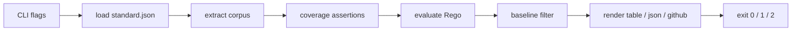

# MDStandardsKit v1 元数据闸门 技术方案

| 字段 | 内容 |
| --- | --- |
| 标题 | MDStandardsKit v1 元数据闸门 技术方案 |
| 主笔 | alang |
| 评审人 | 独立 agent（用户 alang 委托代审） |
| 创建日期 | 2026-10-30 |
| 目标版本 | v1 |
| 关联资源 | [架构](../../architecture/mdstandards-architecture.md) |

## 1. 背景与上下文

### 1.1 系统现状

文档由 Agent 生成，元数据（frontmatter）随生成路径不同而抖动。仓库里没有自动校验；偶尔人工抽查，Agent 写完即进入下游。没有文档引用图，没有状态闸门，也没有存量违规清单。

### 1.2 核心技术痛点

失败链：

1. 一份 Spec 声明 `depends_on` 指向某篇架构文档。
2. Agent 把这篇架构文档及其状态当作开发依据。
3. 没有任何东西验证它存在，也没有东西验证它已被批准。
4. 构建全绿、页面都在、检索正常，代码却照着过期或未批准的架构写完了。

证据：截至 2026-11-01，在 `/Users/alang/Workspace`（排除本仓库与 `.claude` 技能目录）的 411 篇 Markdown 中，只有 1 篇声明了 `depends_on`，且为空数组；真实语料主要用表格维护依赖（`meta_standards`、`spec_upstream_refs`）。因此，直接对既有仓库运行 v1 会因"零依赖边"退出 2；这是 fail-closed 的设计行为，不是缺陷。

缺口：本次没有拿到一次具体事故的时间、涉及文件数与投入工时。这一点记入附录 A。

### 1.3 重构/设计动机

在文档进入下游之前，用机器闸门检查**文档引用图**的完整性，而不是单个文件的格式。v1 只做两条规则：引用存在、目标状态可依赖。闸门必须在 CI 合并时和 Agent 写完自检时都能执行。

触发点：office-hours 设计已于 2026-10-30 批准，v1 进入实现与接入阶段；如果此时仍只靠人工抽查，引用图缺陷会在接入后继续静默进入下游。

### 1.4 非目标

不把闸门做出来的后果见 1.2：失败继续静默，代码继续照着过期或未批准的架构写。

- 必填字段、status 枚举、状态流转、复审有效期、审批来源校验（Deferred to Phase 2）。
- 循环引用检测（Deferred to Phase 2；与 PDS-STD-004 §8.5.6 的偏离见第 7 章）。
- pre-commit 执行点（本次不做）。
- 包管理器分发（本次不做）。
- 多仓库语料合并（Deferred to Phase 2）。

## 2. 目标与非目标

### 2.1 目标

- **G1 引用存在**：每条 `depends_on` 的目标必须在受管语料中；缺失产出 `refs.missing_target`。验收：`TestMissingTargetBlocks`。
- **G2 状态可依赖**：目标 `status` 必须逐字等于 `dependable_statuses` 中的某一项；缺失或大小写不符同样违规。验收：`TestNonDependableStatusBlocks`、`TestLowercaseStatusIsNotDependable`。
- **G3 Fail-closed**：零受管文档在任一 phase 都退出 2；零依赖边与解析错误在 phase ≥ 1 退出 2，不得静默通过。验收：`TestZeroGovernedDocumentsFailsClosed`、`TestZeroEdgesFailsClosed`、`TestExtractErrorFailsClosedInPhase1`。
- **G4 分阶段**：phase 0 不因违规或解析错误阻断（工具级错误仍退出 2）；phase 1 对基线外的新违规退出 1；基线按 `(rule, document, target)` 精确匹配。验收：`TestPhase0NeverBlocks`、`TestBaselineSuppressesKnownViolation`、`TestBaselineDoesNotSuppressRenamedTarget`。
- **G5 稳定输出**：JSON 含 `schema_version`、`findings`、`extract_errors`、`stats`；findings 按 `(rule, document, target)` 排序，字节稳定。验收：`TestJSONSchemaAndStats`。

### 2.2 非目标

- **NG1** 必填字段、status 枚举、状态流转、TTL、审批来源校验（Deferred to Phase 2）。
- **NG2** 循环引用检测（Deferred to Phase 2）。
- **NG3** pre-commit 执行点（本次不做）。
- **NG4** 包管理器分发（本次不做）。
- **NG5** 多仓库语料合并（Deferred to Phase 2）。
- **NG6** `doc_id` 稳定身份（Deferred to Phase 2）。
- **NG7** Rego 非本地内置函数未禁用（本次不做；仅靠 10 秒求值上限兜底）。

## 3. 架构设计与核心方案

### 3.1 总体架构

单二进制，内嵌 OPA 引擎；策略包从仓库 `policy/` 读取，`policy/data/standard.json` 是唯一事实来源。

### 3.2 核心模块职责

| 文件 | 职责 |
|---|---|
| `main.go` | 参数解析、流程编排、策略加载、退出码 |
| `extract.go` | 遍历受管文件、解析 frontmatter、构建语料 |
| `normalize.go` | 有界路径归一化 |
| `report.go` | findings 结构、三种输出格式、基线过滤 |
| `policy/*.rego` | 两条规则 + 载入失败守卫 |
| `policy/data/standard.json` | 受管范围、可依赖状态、标准版本 |

### 3.3 核心数据流

CLI → 策略加载 → 语料抽取 → 覆盖断言 → Rego 求值 → 基线过滤 → 报告渲染 → 退出码。

每个受管文件必须产出一条 document 或一条 extract_error，不会被静默丢弃。

### 3.4 关键选型与约束

- **策略即数据**：受管范围与可依赖状态写在 `standard.json`，不写死在程序里。
- **单 `main` 包**：v1 只有几百行、没有第二个调用方；拆 `cmd/` + `internal/` 属于过早抽象（决策 D2）。
- **路径身份**：文档身份是仓库相对 POSIX 路径，不引入独立 `id` 字段（零迁移成本）。
- **有界归一化**：反斜杠转正斜杠、去掉 `.` 段、折叠重复斜杠与尾斜杠、解析 `..`；解析后仍在仓库根内则接受，越界、绝对路径、含 `://` 的 URL、空路径产生 extract_error。
- **策略完整性**：`-policy-from-head` 从已提交的 `HEAD` 读取策略；工作区策略有未提交改动时打印警告并降级为只报告。

## 4. 详细设计

### 4.1 术语

| 术语 | 含义 |
|---|---|
| 受管文档 | 路径匹配 `standard.governed_globs` 的 Markdown 文件 |
| 语料 | 由受管文档抽取出的 `{documents, extract_errors, stats}` |
| 依赖边 | 某文档 `depends_on` 中的一项，指向另一篇受管文档 |
| 可依赖状态 | `standard.dependable_statuses` 中的字面量，逐字匹配 |

### 4.2 前置条件

- **PREC-001**：`policy/data/standard.json` 存在且可解析。
- **PREC-002**：`standard_version` 为 `"1"`；未知版本必须拒绝。
- **PREC-003**：`dependable_statuses` 与 `governed_globs` 均非空。

违反任一前置条件时，进程以退出码 2 结束，且不产出 findings。

### 4.3 功能需求

#### 4.3.1 抽取

- **REQ-001** 工具应遍历每个 `governed_globs` 模式，把匹配的文件解析为语料中的一条 document。
- **REQ-002** 语料中的每个受管文件应恰好产出一条 document 或一条 extract_error，不得静默丢弃。
- **REQ-003** frontmatter 解析应读取 `type`、`status`、`owner`、`depends_on`；缺失的可选字段留空。
- **REQ-004** 文件没有 frontmatter、没有结束分隔符、YAML 非法或不是映射时，应产出 `extract.parse_error`。
- **REQ-005** `depends_on` 的每一项应按有界规则归一化：反斜杠转正斜杠、去掉 `.` 段、折叠重复斜杠与尾斜杠、解析 `..`；解析后仍在仓库根内则接受，越界、绝对路径、含 `://` 的 URL、空路径均产生 extract_error。
- **REQ-006** 归一化后重复的 `depends_on` 应去重并保持首次出现顺序。
- **REQ-007** 单个文件超过 1 MiB，或 frontmatter 疑似 YAML 别名展开时，应产生 extract_error。

#### 4.3.2 规则

- **REQ-010** 对每条依赖边，若目标路径不在语料中，应产出 `refs.missing_target`。
- **REQ-011** 对每条依赖边，若目标文档的 `status` 不等于任何 `dependable_statuses` 字面量，应产出 `refs.status_not_dependable`；`status` 缺失按同一规则处理。
- **REQ-012** 状态比较应逐字、大小写敏感。
- **REQ-013** `data.standard.dependable_statuses` 不存在时，策略应产出 `policy.load_error`，不得静默通过。

#### 4.3.3 覆盖断言

- **REQ-020** 受管匹配数为 0 时，进程应退出 2。
- **REQ-021** `phase >= 1` 且解析出的文档数为 0 时，进程应退出 2。
- **REQ-022** `phase >= 1` 且依赖边总数为 0 时，进程应退出 2。
- **REQ-023** 每次输出应包含 `documents_matched`、`documents_parsed`、`edges_evaluated` 三个计数。

#### 4.3.4 基线与阶段

- **REQ-030** `phase = 0` 时，进程不因 finding 或 extract_error 阻断（退出 0），但 findings 与 extract_errors 仍应完整输出；零受管文档、策略加载失败等工具级错误仍按 REQ-020 与前置条件退出 2。
- **REQ-031** 在未触发策略降级（REQ-051）的前提下，`phase >= 1` 且未指定 `-baseline` 时，任何 finding 都导致退出 1。
- **REQ-032** 指定 `-baseline` 时，`(rule, document, target)` 与基线条目精确匹配的 finding 应被抑制。
- **REQ-033** extract_error 不得被基线抑制；存在 extract_error 时 `phase >= 1` 退出 2。
- **REQ-034** 目标路径重命名后，旧基线条目失配，违规应重新暴露。

#### 4.3.5 输出

- **REQ-040** `-format json` 输出应包含 `schema_version`、`findings`、`extract_errors`、`stats`。
- **REQ-041** findings 应按 `(rule, document, target)` 排序，保证字节稳定。
- **REQ-042** `-format github` 每条 finding 输出一行 `::error file=<path>::[<rule>] <message>`，并输出一行 `::notice::` 统计。
- **REQ-043** `-out <path>` 应把报告写入文件而不是 stdout。

#### 4.3.6 策略完整性

- **REQ-050** `-policy-from-head` 时，策略包应从 `git HEAD` 读取。
- **REQ-051** `-policy-from-head` 时，若策略目录（含 `standard.json`）或 `-baseline` 指向的文件有未提交改动，应打印警告并降级为只报告（退出 0）。`-baseline` 在 `-root` 之外时同样降级为只报告。
- **REQ-052** `-policy-from-head` 时，若策略目录不在 `-root` 之内，应退出 2。

### 4.4 数据契约

- `standard.json`：`standard_version`、`governed_globs`、`dependable_statuses`、`identity`。
- frontmatter：`type`、`status`、`owner`、`depends_on`。
- findings：`rule`、`document`、`target`、`severity`、`message`。
- baseline：`rule`、`document`、`target` 的 JSON 数组；解析错误永远不能进入基线。
- 退出码：0 干净，或 phase 0 下没有工具级错误的只报告结果；1 阻断状态下的违规；2 工具或抽取错误。

## 5. 非功能性需求

- **NFR-001** 单次全量检查在 1000 篇受管文档上应 < 10 秒（`[estimated]`，待实测）。
- **NFR-002** Agent hook 场景下，≤200 篇文档的 p95 应 < 2 秒，超预算时降级为只警告（尚未实现）。
- **NFR-003** 策略求值应有 10 秒上限。
- **NFR-004** 构建目标为 darwin-arm64 与 linux-amd64。

## 6. 上线与迁移计划

### 6.1 发布策略

- **阶段 0（只报告）**：不因违规或解析错误阻断（退出 0；零受管文档、策略加载失败等工具级错误仍退出 2），上传 `findings.json` 和注解，收集存量。
- **阶段 1（基线 + 阻断新增）**：存量写入 `baseline.json`，只对基线之外的新违规退出非零。
- **阶段 2（清空基线）**：基线清空后转为完全阻断。

晋级条件：连续两周的新增违规数为 0，才允许 0 → 1；基线为空才允许 1 → 2。

### 6.2 数据迁移与兼容性

- 不迁移历史数据；存量违规用 baseline 记录，不修改旧文档来凑合规。
- 真实语料几乎没有 `depends_on`（唯一一处为空数组），直接运行会因"零依赖边"退出 2；回填 `depends_on` 是独立的 v2 任务。
- 策略变更走 CODEOWNERS 评审；`standard_version` 变化时，旧消费者必须显式升级。

### 6.3 验收标准

| ID | 验收方式 | 状态 |
|---|---|---|
| REQ-001 | `TestCleanCorpusPasses` | 已实现并测试 |
| REQ-002 | `TestExtractErrorFailsClosedInPhase1` | 已实现并测试 |
| REQ-003 | `TestCleanCorpusPasses`（间接覆盖 `status`/`depends_on`；`type`/`owner` 无逐字段断言） | 已实现并测试 |
| REQ-004 | `TestExtractErrorFailsClosedInPhase1`（仅覆盖缺 frontmatter） | 已实现并测试 |
| REQ-005 | `TestNormalizeRepoPath`、`TestNormalizedDependsOnResolves` | 已实现并测试 |
| REQ-006 | `TestNormalizeRepoPath` 间接覆盖 | 已实现，去重无独立用例 |
| REQ-007 | 无 | 已实现（大小上限与别名守卫），无测试 |
| REQ-010 | `TestMissingTargetBlocks` | 已实现并测试 |
| REQ-011 | `TestNonDependableStatusBlocks`（缺失 status 未单独覆盖） | 已实现并测试 |
| REQ-012 | `TestLowercaseStatusIsNotDependable` | 已实现并测试 |
| REQ-013 | `TestStandardDataResolvesAsDataStandard`、`status.rego` 守卫 | 已实现；守卫无独立测试 |
| REQ-020 | `TestZeroGovernedDocumentsFailsClosed`（测试覆盖 phase 1） | 已实现并测试 |
| REQ-021 | 无独立用例 | 已实现，无测试 |
| REQ-022 | `TestZeroEdgesFailsClosed` | 已实现并测试 |
| REQ-023 | `TestJSONSchemaAndStats` | 已实现并测试 |
| REQ-030 | `TestPhase0NeverBlocks`、`TestExtractErrorIsReportOnlyInPhase0` | 已实现并测试 |
| REQ-031 | `TestMissingTargetBlocks` | 已实现并测试 |
| REQ-032 | `TestBaselineSuppressesKnownViolation` | 已实现并测试 |
| REQ-033 | `TestExtractErrorFailsClosedInPhase1` | 已实现并测试 |
| REQ-034 | `TestBaselineDoesNotSuppressRenamedTarget` | 已实现并测试 |
| REQ-040 | `TestJSONSchemaAndStats` | 已实现并测试 |
| REQ-041 | 无独立用例 | 已实现，无测试 |
| REQ-042 | 无 | 已实现，无自动化测试 |
| REQ-043 | 无 | 已实现，无测试 |
| REQ-050 | 无 | 已实现，**无测试** |
| REQ-051 | `TestPolicyFromHeadDowngradesOnDirtyBaseline` | 已实现并测试 |
| REQ-052 | 无 | 已实现，**无测试** |
| NFR-001 | 无 | 未实测 |
| NFR-002 | 无 | **未实现** |
| NFR-003 | 无 | 已实现，无测试 |
| NFR-004 | `.github/workflows/release.yml` | 已定义，尚未在 CI 上实际跑过 |

### 6.4 回滚触发条件

- 新规则阻断了一条合法引用（误报）：回退到 phase 0，修正规则后再重新晋级；不得直接加 baseline 掩盖。
- 策略加载失败、零受管文档（任一阶段），以及阻断阶段的零依赖边、解析错误：停止，报告原因；不得改 policy 或文档绕过。
- 目标重命名后旧基线失配：删除过期条目并重新暴露违规；不得新增条目掩盖。
- 回滚步骤：把 CI 的 `-phase` 从 1 调回 0，保留 `findings.json` 作为证据；规则修复合入后再晋级。

## 7. 替代方案与权衡

### 7.1 替代方案

- **Status Quo：人工抽查**。不选：Agent 产出是指数的，人工吞吐固定；失败是静默的，抽查只能覆盖抽样。
- **单文件格式检查器**。不选：失败模式是文档引用图，不是单个文件的字段格式；单文件检查抓不到"目标不存在或未批准"。
- **语料 + JSON Schema + 薄校验器**。不选：规则写在代码里，标准变更需要改代码；策略无法作为独立事实来源评审。v1 选择 OPA/Rego，把规则放在 `policy/`。

### 7.2 已知限制与偏离

1. **语料尚未回填**：真实语料几乎没有 `depends_on`（唯一一处为空数组），直接对真实仓库运行会因"零依赖边"退出 2。这是设计中的 fail-closed 行为，不是缺陷。
2. **审批来源不可信**：`status: Approved` 由 Agent 与文档作者共用同一条写入路径，v1 不校验来源。
3. **循环引用未检测**：与 PDS-STD-004 §8.5.6 存在偏离。
4. **状态词汇比 PDS 更严格**：`Draft` / `In Review` / `Deprecated` / `Archived` 引用一律判违规，且不解析引用处注记；身份用仓库相对路径而非 `doc_id`。与 PDS-STD-004 §8.5.2/§8.5.8、PDS-STD-001 §9.3.3 的偏离与收回条件见架构文档 §9。
5. **Rego 非本地内置函数未禁用**（例如 `http.send`），依靠 10 秒求值上限兜底。
6. **Agent hook 未安装时是静默无操作**，当前无检测手段。

### 7.3 变更影响

修改本规格中任意 REQ 编号的语义，都必须同步更新 `docs/architecture/mdstandards-architecture.md` 的对应章节、`policy/` 中的规则，以及 `main_test.go` 的验收用例。三处不一致即为规格漂移。

## 附录 A：未决问题

- 缺一次具体事故的时间、涉及文件数、后果与投入工时；当前证据是 411 篇 Markdown 中仅 1 篇声明空 `depends_on` 的度量，不是事故。
- 谁有权把 `status` 改成 `Approved`；v2 用什么来源校验机制。
- Agent hook 未安装时的静默缺口如何检测。
- 第一份真实 Spec 必须先依赖一份已批准的架构文档；启动顺序需在迁移时明确。
