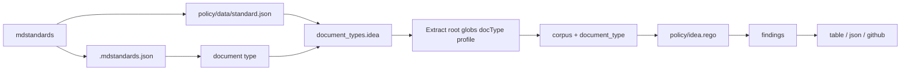

# MDStandardsKit idea 类型 技术方案

| 字段 | 内容 |
| --- | --- |
| 标题 | MDStandardsKit idea 类型 技术方案 |
| 主笔 | alang |
| 评审人 | 独立 agent 冷读 + `/plan-eng-review` |
| 创建日期 | 2026-11-02 |
| 目标版本 | v0.2.0 |
| 关联资源 | [架构](../../architecture/mdstandards-architecture.md)、[设计记录](../../designs/idea-document-type.md) |

## 1. 背景与上下文

### 1.1 系统现状

`~/Workspace/ideas` 是一个独立的想法记录库。一个想法一个文件，路径为 `YYYY/YYYY-MM-DD/<slug>.md`，frontmatter 有 `id`、`title`、`date`、`tags`、`status`，正文有四个二级标题：一句话描述、想法、为什么有意思、下一步。

`scripts/new` 负责建文件、生成 8 位大写 ID、校验标题非空、校验日期格式与 ID 唯一。它不检查章节是否存在、占位符是否替换、状态是否合法、日期与目录是否一致，也不评价内容。

### 1.2 核心技术痛点

失败链：

1. Agent 按模板建了一个想法文件。
2. 章节缺失、模板注释还在、状态写错、日期与目录对不上，没有任何工具发现。
3. 想法进入库，之后靠人翻文件时才发现问题；内容层面也没有统一标准判断「值不值得现在推进」。

证据：截至 2026-11-02，`~/Workspace/ideas` 有 5 篇想法；在没有结构闸门之前，`scripts/new` 建出的文件只保证 title/date/id 三项。2026-11-02 的冒烟测试对「万花筒」跑完 idea rubric，headline 25.0、diagnostic 35.0，证明内容评分链路能产出可审计的报告。

### 1.3 重构/设计动机

把「结构对不对」和「想法值不值得推进」拆成两件事：结构错误在记录时阻断；内容评分只诊断，不阻止入库。触发点是想法库开始承载越来越多的 Agent 生成内容，而现有 `scripts/new` 只管文件名和 ID。

### 1.4 非目标

不做结构闸门的后果见 1.2：空壳想法继续入库，内容低分的想法和人判断混在一起。本次明确不做：

- 想法状态流转校验（Deferred to Phase 2）。
- 跨想法引用（`related: [ID]`）（Deferred to Phase 2）。
- bet card / kill criterion 的完整字段（Deferred to Phase 2；rubric 保留 `next.kill` 诊断项）。
- 批量整理与 triage UI（本次不做）。
- Spec / README / ADR 的校验（不在本规格范围）。

## 2. 目标与非目标

### 2.1 目标

- **G1 类型声明**：仓库根 `.mdstandards.json` 声明 `{"type":"idea"}`；缺失、损坏、未知 type、未知键都 exit 2。验收：`TestIdeaConfigFailsClosed`、`TestIdeaValidRepo`。
- **G2 结构规则**：ID、日期、目录、状态、tags、标题、占位符、路径形状各有一条独立规则。验收：`TestIdeaStructuralFindings`、`TestIdeaDuplicateID`。
- **G3 记录不误伤**：空正文、`暂无`、`目前说不清，因为……` 不产生结构 finding。验收：`TestIdeaValidRepo` 与真实 5 篇语料 phase 1 通过。
- **G4 内容评分**：rubric 四个 core 项计算「推进就绪度」，成熟度和「非显而易见」只做诊断；独立 reviewer 先盲读再评分；`qualitycheck` 复算分数并验证逐字证据。验收：`-validate-rubric`、万花筒冒烟报告。
- **G5 spec 不回归**：spec 的 `-dump-corpus` 输出逐字节不变；`make check` 全绿。验收：`TestSpecDumpCorpusGolden`、`make check`。

### 2.2 非目标

- **NG1** 想法状态流转校验（Deferred to Phase 2）。
- **NG2** 跨想法引用与图谱（Deferred to Phase 2）。
- **NG3** 自动改写想法内容（本次不做；评分只提示）。
- **NG4** Windows 分发（本次不做）。
- **NG5** 内容分作为阻断门槛（本次不做；v0.2.0 只诊断）。

## 3. 架构设计与核心方案

### 3.1 总体架构



### 3.2 新增、改造、保持不变

**新增**：

- `policy/idea.rego`：idea 结构规则。
- `skills/idea-writer/`：SKILL、rubric、reviewer、calibration、findings schema。
- `.mdstandards.json` 读取与类型解析。
- `docs/quality/ideas/` 报告目录约定。

**改造**：

- `extract.go`：`Extract(root, globs, docType, profile)`；idea 字段与章节解析；`date` 同时接受字符串和 `time.Time`。
- `main.go`：类型→globs 解析；配置失败 fail closed；零依赖边断言按 `graph` 生效。
- `policy/refs.rego`、`policy/status.rego`：显式 spec 类型守卫。
- `tools/qualitycheck`：`-title` / `-target-label`；findings schema 增加 `guess`。

**保持不变**：

- spec 的规则、退出码和 `-dump-corpus` 字节输出。
- 单 `main` 包，不拆 `cmd/` + `internal/`。
- 不新增运行时依赖。

## 4. 详细设计

### 4.1 数据模型

idea 文档在 corpus 里额外带：

| 字段 | 含义 |
|---|---|
| `document_type` | 语料级类型，idea 时为 `idea` |
| `id` / `title` / `date` / `tags` | frontmatter 事实；title 会 trim |
| `sections` | 每个 ATX 标题的 title、level、body_chars、empty、placeholder |
| `missing` | 缺失的必填字段 |
| `date_invalid` | 日期格式对但不是真实日期，或带时间 |
| `tags_invalid` | tags 不是字符串列表 |

这些字段都带 `omitempty`，spec 文档不填充。

### 4.2 命令行

```bash
mdstandards -root ~/Workspace/ideas -policy <plugin>/policy -phase 0|1 -format table|json
```

`-policy` 相对当前工作目录解析；idea 仓库必须显式传插件的 policy 目录，或设置 `MDSTANDARDS_POLICY_DIR`。

### 4.3 规则与退出码

规则见架构文档 §5.2。退出码：

| 码 | 含义 |
|---|---|
| 0 | 干净，或 phase 0 |
| 1 | phase 1 有结构 finding |
| 2 | 配置/策略加载失败、未知 type、零受管文档、解析错误 |

### 4.4 日期与路径

- 路径必须恰好三层：`YYYY/YYYY-MM-DD/<slug>.md`。
- 年份目录必须是 `20xx`，日期目录必须是 `YYYY-MM-DD`。
- frontmatter `date` 必须等于日期目录，年份必须等于年份目录。
- `date` 可以是 YAML 字符串，也可能被 YAML 解析成 `time.Time`；两种都归一化为 `YYYY-MM-DD`。非零时钟的 datetime 报 `idea.date_invalid`。

### 4.5 内容评分

- rubric：`skills/idea-writer/idea/quality/rubric.v1.yaml`。
- core 项：`claim.standalone`(w2)、`problem.trigger`(w2)、`next.testable`(w3)、`next.bounded`(w1)。
- headline：0–100，三档 0–39 / 40–69 / 70–100；成熟度和 `why` 只做诊断。
- 独立 reviewer 先只读 title + 一句话描述，写 `guess`，再读正文；`qualitycheck` 验证证据存在和分数算术，不验证盲读是否真实。
- 校准：`calibration/ideas.v1.yaml` 记录 5 篇人工分诊标签，留 1 篇；比较按「推进 vs 不推进」二分，至少 3/5 一致。

## 5. 非功能性需求

- **NFR-1 确定性**：同一语料、同一 policy 的 JSON 输出字节稳定；spec `-dump-corpus` 与改造前逐字节一致。
- **NFR-2 性能**：5 篇 idea 的 phase 1 在 1 秒内完成；单文件上限沿用 1 MiB。
- **NFR-3 安全**：`.mdstandards.json` 使用 `DisallowUnknownFields`；配置错误 fail closed；frontmatter 仍按不可信输入处理。
- **NFR-4 可观测性**：每条 finding 带 `rule`、`document`、`target`、`message`；内容报告带 rubric 版本、目标 SHA-256、reviewer 会话。
- **NFR-5 兼容性**：不新增运行时依赖；插件 binary 与 policy 同版本发布。

## 6. 上线与迁移计划

1. 在 `~/Workspace/ideas` 增加 `.mdstandards.json`。
2. `scripts/new` 在工具可用时跑 phase 0 检查；不可用只打印提示。
3. 插件版本升到 `0.2.0`，release tag 必须与 `plugin.json` 一致。
4. 发布冒烟：对 `testdata/idea-repo` 跑 phase 1；对真实 ideas 仓库跑 phase 1。
5. 回滚：移除 `.mdstandards.json` 或回退插件版本；spec 行为不受影响。

## 7. 替代方案与权衡

| 方案 | 优点 | 缺点 | 结论 |
|---|---|---|---|
| Status Quo | 零改动 | 空壳想法继续入库，内容无标准 | 否决 |
| 方案 A：类型配置 + 专用 Rego | 最小改动、spec 不动、规则集中在 policy | 第三种类型要再补代码 | **采用** |
| 方案 B：声明式类型 schema | 类型系统更通用 | 重构大、测试迁移、过度抽象风险 | 延后 |
| 方案 C：独立 `mdstandards idea` 命令 | 不碰 spec policy | 解析重复、类型支持名义化 | 否决 |

## 附录 A：未决问题

- 状态流转校验是否进入 v0.3。
- 是否用 `id` 做跨想法引用。
- 内容分是否在积累足够校准样本后升级为阻断门槛。
