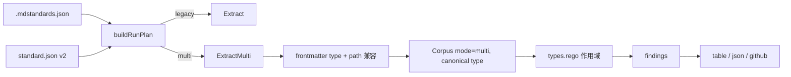

# MDStandardsKit 多文档类型路由 技术方案

| 字段 | 内容 |
| --- | --- |
| 标题 | MDStandardsKit 多文档类型路由 技术方案 |
| 主笔 | 维护者 |
| 评审人 | 独立 agent 工程评审、需求/规范评审、质量评审（2026-11-12） |
| 创建日期 | 2026-11-12 |
| 目标版本 | v0.3.0 |
| 关联资源 | [架构](../../architecture/mdstandards-architecture.md)、[SPEC-002](../SPEC-002-idea-type/spec.md) |

## 1. 背景与上下文

### 1.1 系统现状

`mdstandards` 是单二进制元数据闸门：读取仓库根 `.mdstandards.json` 声明的**仓库级**文档类型，从 `policy/data/standard.json` 取出对应档案，遍历该类型的 globs，构建语料后交给 Rego 求值。

当前支持两种类型：

- `spec`：`refs.missing_target`、`refs.status_not_dependable` 两条引用图规则。
- `idea`：一组结构与占位符规则。

文件 frontmatter 的 `type:` 会被解析并写入 corpus 的 `Document.Type`，但**不参与规则路由**。`main.go` 一次运行只选择一个 `docType`；`policy/refs.rego`、`policy/status.rego`、`policy/idea.rego` 都按语料级 `input.document_type` 守卫。

本仓库自身已经有多种受管文档：`docs/specs/README.md` 是 `type: index`，`changelog.md` 是 `type: changelog`，`tasks.md` 是 `type: tasks`，架构文档是 `type: architecture`，spec 是 `type: spec`。它们目前都被同一套 spec 规则扫描，或干脆不在同一类型范围内。

### 1.2 核心技术痛点

失败链：

1. 仓库里同时存在 spec、架构、changelog、tasks、index、idea 等多种文档。
2. `.mdstandards.json` 只能声明一种类型。要检查 idea，就得把仓库切到 `{"type":"idea"}`，spec 的引用图检查随之消失；要检查 spec，idea 规则又不再运行。
3. frontmatter `type:` 只是被记录下来，不决定规则。把一篇 spec 改成 `type: tasks` 不会改变任何检查结果；反过来，所有类型都被 spec 规则扫描，changelog 的空 `depends_on`、index 的 `status` 也会被当作引用图节点。

证据（2026-11-12 代码审计与仓库实测）：

- `extract.go:154-156` 写入 `Document.Type`，但 `policy/*.rego` 中没有任何 `doc.type` 引用。
- `main.go:139-170` 的类型解析是单值；`TestIdeaRulesDoNotRunForSpec` 明确断言仓库级单选。
- 根仓库 `phase 1` 实测扫描 10 篇受管文档，其中只有 3 篇是 `type: spec`；其余 7 篇（architecture / changelog / tasks / index）仍被 spec 规则扫描。
- 现有仓库根没有 `.mdstandards.json`，`make check` 走 legacy spec，无法同时验证 idea 规则。

### 1.3 重构/设计动机

用户仓库开始同时承载多种文档，需要一次运行、按文件元数据识别类型、分别套用规则。触发点是“类型已经是文件事实，但工具只认仓库级配置”，继续用仓库级单选会让检查范围随着配置切换而丢失。

目标是把类型声明从“仓库模式”升级为“文件事实 + 仓库启用列表”，同时保持 legacy 单类型模式完全兼容。

### 1.4 非目标

不做多类型分流的后果见 1.2：要么一次只能检查一种类型，要么所有类型被同一套规则误伤。本次明确不做：

- 完整的声明式规则 DSL 或通用类型 schema（Deferred to Phase 2）。
- 把 `taskscheck` 并入 `mdstandards` 类型系统（Deferred to Phase 2）。
- per-type baseline、per-type 审批来源校验、状态流转校验（本次不做）。
- per-type `dependable_statuses`（Deferred to Phase 2）。
- 把 `docs/designs/`、`skills/` 扩展为受管范围（本次不做）。
- 自动迁移既有仓库的 `.mdstandards.json`（本次不做；提供迁移 recipe）。

## 2. 目标与非目标

### 2.1 目标

- **G1 配置双模式与校验**：`.mdstandards.json` 支持 legacy `{"type":"..."}` 与 multi `{"types":[...]}`；文件缺失仍是 legacy spec；`type`/`types` 恰好一个非 null；`{}`、显式 null、空/重复 `types`、未知键都 exit 2；legacy 只允许 `spec`/`idea`；`types` 条目 trim 后匹配档案。验收：`TestLoadRepoConfig*`、`TestMultiConfig*`、`TestLegacyArchitectureTypeRejected`。
- **G2 文件级路由与信任边界**：multi 模式下每个受管文件按 frontmatter `type:` 选择档案；缺失、非字符串、空串、未知、未启用、与路径不兼容都产生 routing error；发现范围始终包含顶层 `governed_globs`；`--policy-from-head` 从 HEAD 读取 `.mdstandards.json`。验收：`TestMultiRouting*`、`TestMultiDiscoveryBaseline`、`TestPolicyFromHeadConfig*`。
- **G3 规则作用域**：每个类型用 `rule_set` 选择 `spec` / `idea` / `none`；`spec` 规则与 `idea` 规则只作用于对应类型；rule ID 不变。验收：`TestMultiRuleScope*`、`TestMultiIdeaRulesScoped`。
- **G4 覆盖与边语义**：零受管文档、phase ≥ 1 零解析仍 exit 2；multi 模式只统计 `graph: true` 文档的边；仅当语料中至少有一篇 `graph: true` 文档时要求全语料非零边；单个 graph 类型零文档只 warning。验收：`TestMultiCoverage*`。
- **G5 legacy 兼容与版本**：legacy spec 的 `-dump-corpus` 逐字节不变；legacy idea 行为不变；既有退出码、rule ID、finding 排序不变；新二进制接受 `standard_version` 1/2，multi 要求 2。验收：`TestSpecDumpCorpusGolden`、`TestIdea*`、`TestStandardVersionMatrix`、`make check`。
- **G6 文档、迁移与发布**：同步 SPEC、架构、README、标准、fixture、CI 与 release note；提供 phase 0 → phase 1 迁移 recipe；发布 `v0.3.0` 与 `standard_version: 2` 说明。验收：架构/README/standard 更新、`testdata/mixed-repo`、CI mixed smoke、`plugin.json` v0.3.0、release note、文档评审。架构/README/standard 更新属于 Gate 1 之后的 Phase B 交付物，不作为本次批准前置；Spec 状态改为 `Approved` 的同一变更创建 `tasks.md` 并写入最终 `spec_sha256`。

### 2.2 非目标

- **NG1** 通用声明式类型 schema / 规则 DSL（Deferred to Phase 2）。
- **NG2** `taskscheck` 合并进 `mdstandards`（Deferred to Phase 2）。
- **NG3** per-type baseline 与 per-type 审批来源校验（本次不做）。
- **NG4** per-type `dependable_statuses`（Deferred to Phase 2）。
- **NG5** per-type 零文档覆盖断言（本次只 warning；Deferred to Phase 2）。
- **NG6** 扩展受管范围到 `docs/designs/`、`skills/`（本次不做）。
- **NG7** 自动迁移工具或自动改写 `.mdstandards.json`（本次不做）。
- **NG8** 文档状态流转校验（本次不做；沿用现有 `status` 语义；审批来源校验归 NG3）。

## 3. 架构设计与核心方案

### 3.1 总体架构

全局组件、代码布局与执行点见 [架构文档](../../architecture/mdstandards-architecture.md)；本节只描述多类型路由的变更范围。



### 3.2 新增、改造、保持不变

**新增**：

- `.mdstandards.json` 的 `{"types":[...]}` 形态与运行计划 `buildRunPlan`。
- `extract.go` 的 `ExtractMulti` 与 `multiRoute`。
- `policy/types.rego`：`is_spec_scope` / `is_idea_scope` / `profile_for` 等作用域 helper。
- `Corpus.Mode`（仅 multi 输出 `"multi"`）。
- `testdata/mixed-repo/`、`plan_test.go`、`multi_test.go`、`multi_rego_test.go`。
- 根仓库 `.mdstandards.json` dogfood 与 CI mixed smoke。

**改造**：

- `main.go`：配置加载、运行计划、覆盖断言、`--policy-from-head` 读取 config。
- `extract.go`：按 profile 驱动的结构字段提取；canonical type；routing error。
- `policy/refs.rego`、`policy/status.rego`、`policy/idea.rego`：从语料级守卫改为逐文档作用域。
- `policy/data/standard.json`：`standard_version: 2`，新增 `rule_set`、`graph` 校验与类型档案。
- `loadStandard`：严格字段校验，typo fail-closed。

**保持不变**：

- legacy 单类型模式的 globs 解析、退出码、`document_type` 语义、`-dump-corpus` 字节输出。
- 所有既有 rule ID、finding 排序、baseline 匹配规则。
- 单 `main` 包、不新增运行时依赖。

### 3.3 数据流与边界

配置决定运行计划，运行计划决定发现范围与档案；提取阶段完成逐文件判型；Rego 阶段按 `rule_set` 选作用域。类型判断、路径兼容、配置加载都在提取前或提取中完成，避免规则求值阶段才暴露配置错误。

### 3.4 关键选型与约束

- **opt-in 多类型模式**：只有 `{"types":[...]}` 才启用；缺失文件或 `{"type":"..."}` 继续 legacy，避免存量仓库行为漂移。
- **frontmatter 是类型事实，路径是兼容性约束**：类型由 `type:` 决定，但文件路径必须命中该类型的 globs（`spec` 用顶层 `governed_globs`），防止把 spec 标成 `tasks` 后逃逸规则。
- **`rule_set` 是轻量规则选择器**：不实现通用 schema；`spec` / `idea` / `none` 三个作用域足以覆盖当前仓库。
- **发现范围始终含顶层 globs**：顶层 `governed_globs` 覆盖的未启用类型文件会被扫描并报 routing error；不在顶层 globs 的 opt-in 类型（如 idea）若未启用则不会被发现，迁移时需显式列出。
- **`standard_version` 升到 2**：旧二进制遇到 2 直接 exit 2；新二进制接受 1（legacy）与 2（multi 要求 2）。新增字段本身向后兼容，但版本号让 fail-closed 更明确。
- **legacy 只允许 `spec` / `idea`**：新增的 `architecture` 等档案只能通过 multi 模式启用，避免 legacy 加载到“没有规则”的类型后静默通过。
- 详细方案对比与淘汰理由见第 7 章。

## 4. 详细设计

### 4.1 术语与前置条件

| 术语 | 含义 |
|---|---|
| legacy 模式 | `.mdstandards.json` 缺失或使用 `{"type":"..."}`；仓库级单类型 |
| multi 模式 | `.mdstandards.json` 使用 `{"types":[...]}`；逐文件判型 |
| 启用类型 | 出现在 `types` 中、且在 `document_types` 有档案的类型 |
| routing error | 文件无法判型或判型与路径不兼容，计入 `extract_errors` |
| `rule_set` | 类型套用的规则作用域：`spec` / `idea` / `none` |
| canonical type | trim 后、与档案键一致的 frontmatter 类型；写入 `Document.Type` |
| 降级 | 性能降级：phase 1 单次超预算，仅影响 phase 1；配置降级：`--policy-from-head` 检测到工作区策略/配置/baseline 有未提交改动，影响 phase ≥ 1（含 phase 2）的 blocking。降级不关闭配置与覆盖错误 |

前置条件：仓库根有可读的 policy bundle；multi 模式要求 `standard_version: 2`；每个受管文件有可解析的 frontmatter。

### 4.2 配置契约

```json
{"type": "idea"}
```

```json
{"types": ["spec", "architecture", "changelog", "tasks", "index"]}
```

| 输入 | 行为 |
|---|---|
| 文件缺失 | legacy spec |
| `{"type":"spec"}` / `{"type":"idea"}` | 对应 legacy 类型 |
| `{"type":"architecture"}` | exit 2：该类型必须走 multi 模式 |
| `{"type":"spec","types":null}` | legacy spec：`types` 为 null 视为未提供 |
| `{"type":null,"types":["spec"]}` | multi：`type` 为 null 视为未提供 |
| `{"types":[...]}` 非空、无重复、条目非空 | multi 模式 |
| `{}`、`{"type":null}`、`{"types":null}` | exit 2：必须恰好一个模式键非 null |
| `type` 与 `types` 都非 null | exit 2 |
| `{"type":""}` | exit 2 |
| `types` 为空、条目为空或重复（trim 后） | exit 2 |
| 未知键、尾随数据 | exit 2 |
| `types` 中类型不在 `document_types` | exit 2（求值前） |

`types` 条目 trim 后必须非空且唯一；启用类型按 trim 后的值匹配 `document_types` 键与 frontmatter canonical type。legacy `type` 精确匹配 `spec` / `idea`，不做 trim。multi 模式没有隐式类型：每个被 glob 命中的文件必须带已启用且与路径兼容的 `type:`。

### 4.3 数据模型与契约

`standard.json` 的唯一事实来源：

```json
{
  "standard": {
    "standard_version": "2",
    "governed_globs": ["docs/specs/**/*.md", "docs/architecture/**/*.md"],
    "dependable_statuses": ["Approved", "Published"],
    "identity": "repo_relative_path",
    "document_types": {
      "spec":         {"rule_set": "spec", "graph": true},
      "architecture": {"rule_set": "spec", "graph": false, "globs": ["docs/architecture/**/*.md"]},
      "adr":          {"rule_set": "none", "graph": false, "globs": ["adr/**/*.md"]},
      "changelog":    {"rule_set": "none", "graph": false, "globs": ["docs/specs/**/changelog.md"]},
      "tasks":        {"rule_set": "none", "graph": false, "globs": ["docs/specs/**/tasks.md"]},
      "index":        {"rule_set": "none", "graph": false, "globs": ["docs/specs/README.md"]},
      "idea": {
        "rule_set": "idea",
        "graph": false,
        "globs": ["20*/**/*.md"],
        "required_fields": ["id", "title", "date", "tags", "status"],
        "status_values": ["萌芽", "探索中", "已落地", "搁置"],
        "required_headings": ["一句话描述", "想法", "为什么有意思", "下一步"],
        "id_pattern": "^[A-Z]{8}$",
        "date_field": "date",
        "placeholder_markers": [
          "<!-- 一句话说清楚这个想法是什么。写不出来就说明还没想清楚。 -->",
          "<!-- 展开说说：它是什么样子的？怎么运作？ -->",
          "<!-- 它解决了什么问题？或者只是让你好奇？ -->",
          "optional:outside-voice",
          "<!-- 如果想推进，最小的一步是什么？ -->"
        ]
      }
    }
  }
}
```

校验规则：

- `standard_version`：只接受 `"1"` / `"2"`；缺失、空串或其他值 → exit 2；multi 模式要求 `"2"`。
- `rule_set`：字段存在时必须是 `spec` / `idea` / `none`；multi 模式下每个启用类型必须存在且非空；legacy v1 档案允许缺省，按 effective type 回退。空值或未知值 → exit 2。
- `graph`：可选，缺省 `false`；只有 `rule_set: spec` 允许 `true`，`none` / `idea` 配 `true` → exit 2。`rule_set: spec` 若要启用零边覆盖必须显式 `true`；shipped policy 的 `spec` 为 `true`。
- 非 `spec` 类型的 `globs` 不得为空；`document_types.spec.globs` 若存在则忽略，顶层 `governed_globs` 是 spec 的唯一发现范围。
- multi 启用 `spec` 时顶层 `governed_globs` 不得为空；顶层 `dependable_statuses` 不得为空，否则 exit 2（legacy spec 沿用现有检查）。
- `rule_set: idea` 必须有 `required_fields`、`status_values`、`required_headings`、`id_pattern`、`placeholder_markers`；`date_field` 可选，缺省 `date`。
- `dependable_statuses` 只用顶层；per-type 覆盖延后到 Phase 2。
- `loadStandard` 使用严格字段校验，未知字段 exit 2。

Corpus 在 legacy 契约上追加：

```json
{
  "documents": [
    {"path": "docs/specs/SPEC-003/spec.md", "type": "spec", "status": "In Review",
     "depends_on": ["docs/architecture/mdstandards-architecture.md"]}
  ],
  "extract_errors": [],
  "stats": {"documents_matched": 1, "documents_parsed": 1, "edges_evaluated": 1},
  "mode": "multi"
}
```

- `mode` 追加在现有字段之后，仅 multi 输出；legacy 不出现。
- multi 不输出 `document_type`。
- 同一 normalized path 只处理一次；`documents` 与 `extract_errors` 按 `path` 排序；空集合输出 `[]` 而非 `null`。
- legacy 的字段顺序、`omitempty` 行为、`document_type` 语义不变。

### 4.4 接口与协议

CLI 不变：

```bash
mdstandards -root . -policy ./policy -phase 0|1|2 -format table|json|github [-out findings.json]
```

- 配置输入：`.mdstandards.json`（见 4.2）与 `policy/data/standard.json`（见 4.3）。
- 语料响应：`-dump-corpus` 输出 Corpus JSON（见 4.3），legacy 逐字节兼容。
- 规则输出：`table` / `json` / `github`，findings 与 `extract_errors` 分离；退出码见 4.6。
- `-policy` 相对当前工作目录解析；`-root` 只决定受管范围；`--policy-from-head` 要求 policy 目录在 `-root` 内。

### 4.5 核心流程与时序

1. 读取 `.mdstandards.json`，构建运行计划：
   - legacy：沿用现有类型解析，只允许 `spec` / `idea`。
   - multi：校验启用类型；发现范围 = 顶层 `governed_globs` ∪ 所有启用类型的 `globs`，按首次出现去重。
2. 遍历发现范围，对每个文件：
   - 解析 frontmatter。
   - 读取 `type`，trim 后作为 canonical type。
   - 缺失 / 非字符串 / 空串 → routing error。
   - 不在启用类型集合 → routing error。
   - 路径不命中该类型 globs（类型 `spec` 用顶层 globs）→ routing error。
   - 通过后按该类型档案提取结构字段；canonical type 写入 `Document.Type`。
3. routing error 计入 `extract_errors`，与解析错误同语义：phase 0 只报告；phase ≥ 1 未降级时 exit 2；降级时 report-only。
4. Rego 按 `rule_set` 求值：
   - `spec`：`refs.*`；`idea`：`idea.*`；`none`：不跑规则，但仍可作为依赖目标。
   - 只有 `graph: true` 文档的 `depends_on` 计入 `Stats.Edges`。
5. 覆盖断言与退出码见 4.6。

规则作用域矩阵：

| `rule_set` | `refs.*` | `idea.*` | 可作为依赖目标 | 参与零边断言 |
|---|---|---|---|---|
| `spec` | 是 | 否 | 是 | 是（仅 `graph: true`） |
| `idea` | 否 | 是 | 是 | 否 |
| `none` | 否 | 否 | 是 | 否 |

**legacy 作用域**：legacy spec 的 `is_spec_scope` 在 `input.document_type` 缺省或为 `spec` 时成立；`profile_for` 显式返回空档案；`dependable_for` 只读顶层 `dependable_statuses`。legacy idea 的 `is_idea_scope` 只在 `input.document_type == "idea"` 时成立，`profile_for` 取 `document_types.idea`。multi 模式按 `doc.type` 查档案、按 `rule_set` 选作用域；档案缺 `rule_set` 时产出 `policy.load_error`，防止直接 `opa eval` 时静默全绿。legacy 的这两个分支必须与现有行为逐项一致，是 G5 的推导依据。

### 4.6 异常处理与错误码

| 类别 | 示例 | 处理 |
|---|---|---|
| 配置错误 | 双键、空 types、未知 profile、版本不符、空顶层 globs/statuses | 求值前 exit 2 |
| routing error | 缺 type、未知/未启用 type、type/path 不匹配 | `extract_errors`；phase ≥ 1 未降级 exit 2，降级 report-only |
| 解析错误 | 无 frontmatter、YAML 非法 | `extract_errors`；同上 |
| 规则 finding | `refs.*`、`idea.*` | phase ≥ 1 未降级 exit 1；降级 report-only |
| 策略载入失败 | Rego 编译失败、标准缺失 | CLI 求值前 exit 2；Rego `policy.load_error` 仅用于直接 `opa eval` 时不静默全绿 |

覆盖断言仅适用于门禁运行；`-dump-corpus` 直接输出语料并 exit 0，不执行零文档/零解析/零边断言（配置/策略加载错误仍 exit 2）：

- 零受管文档：exit 2。
- phase ≥ 1 零解析文档：exit 2。
- `plan.Graph && graphDocs > 0 && Stats.Edges == 0`：exit 2；单个 graph 类型零文档只 warning。
- 已启用类型零文档：stderr warning，按类型名排序，不阻断。
- 配置/策略加载失败、零受管文档、零解析、零边断言在降级时仍 exit 2。

退出码：

| 码 | 含义 |
|---|---|
| 0 | 干净；phase 0；phase 1 性能降级；`--policy-from-head` 降级 |
| 1 | phase ≥ 1 未降级且存在 blocking finding |
| 2 | 配置/策略加载失败、版本不支持、routing error（未降级）、零受管文档、零解析、零边断言失败 |

### 4.7 信任边界

- frontmatter 由被检查 Agent 写入，是不可信输入；`type:` 是 load-bearing 字段。
- 顶层 `governed_globs` 始终参与发现，缩小 `types` 不能让它覆盖的文件静默消失；不在顶层 globs 的 opt-in 类型（如 idea）若未启用则不会被发现，迁移时必须显式列出。
- type/path 兼容校验阻止“把 spec 标成 tasks”这类直接逃逸。
- `standard.json` 的 `rule_set/globs` 与 `.mdstandards.json` 的 `types` 同属 load-bearing，需要 CODEOWNERS/评审保护；CI/hook 应使用 `--policy-from-head`。
- `--policy-from-head` 从 HEAD 读取策略与 `.mdstandards.json`；HEAD 不存在配置时按 legacy spec。工作区配置被修改、未跟踪或被 ignore 时降级 report-only。
- 已知残留风险：未使用 `--policy-from-head` 的运行点仍可能被工作区配置降级绕过；把 `spec.md` 改成同一路径允许范围内的其他类型也无法完全阻止。README 必须说明 `type:` 与配置需要评审保护。

### 4.8 需求编号

- **REQ-001** legacy `{"type":"spec"|"idea"}` 与缺失文件行为不变；覆盖 G1/G5；验收 `TestLegacy*`。
- **REQ-002** multi `{"types":[...]}` 解析、null 语义与互斥校验；覆盖 G1；验收 `TestLoadRepoConfig*`。
- **REQ-003** 启用类型存在、档案合法、顶层 globs/statuses 非空；覆盖 G1/G3；验收 `TestBuildRunPlan*`。
- **REQ-004** 逐文件 frontmatter 判型 + type/path 兼容；覆盖 G2/G6；验收 `TestMultiRouting*`。
- **REQ-005** routing error 的 fail-closed 与 phase/降级语义；覆盖 G2；验收 `TestMultiRoutingPhase*`。
- **REQ-006** `rule_set` 三作用域与逐文档 Rego 守卫；覆盖 G3；验收 `TestMultiRuleScope*`。
- **REQ-007** 发现范围始终包含顶层 `governed_globs`；覆盖 G2/G6；验收 `TestMultiDiscoveryBaseline`。
- **REQ-008** multi 边统计、零边断言、零文档 warning；覆盖 G4；验收 `TestMultiCoverage*`。
- **REQ-009** `--policy-from-head` 读取并保护 config；覆盖 G2/G6；验收 `TestPolicyFromHeadConfig*`。
- **REQ-010** legacy corpus/退出码/rule ID 逐字节兼容；覆盖 G5；验收 `TestSpecDumpCorpusGolden`。
- **REQ-011** `standard_version` 1/2 接受与拒绝矩阵；覆盖 G5/G6；验收 `TestStandardVersionMatrix`。
- **REQ-012** 错误分类、canonical type、可观测 warning；覆盖 G2/G4；验收 `TestMultiErrorReasons`。
- **REQ-013** 文档、迁移与发布同步；覆盖 G6；验收架构/README/standard、`testdata/mixed-repo`、CI smoke、`plugin.json` v0.3.0、release note。

## 5. 非功能性需求

- **NFR-1 确定性**：同一语料、同一 policy 的 JSON 输出字节稳定；legacy `-dump-corpus` 与改造前逐字节一致。验收：`TestJSONByteStableAcrossRuns`、`TestSpecDumpCorpusGolden`。
- **NFR-2 性能**：沿用现有 2 秒预算（`main.go:26` 的 `agentHookBudget`）；新增路由与 path 校验为 O(类型数 × glob 数)，单文件开销 [estimated] < 1ms，上线前用 `perf_test.go` 实测。验收：`perf_test.go`、phase 1 预算测试。
- **NFR-3 安全**：配置与标准严格解析；routing error 100% 计入 `extract_errors`，不静默；`--policy-from-head` 覆盖 config。验收：`TestLoadRepoConfig*`、`TestMultiRouting*`、`TestPolicyFromHeadConfig*`。
- **NFR-4 可观测性**：每条 routing error 带明确 reason；启用类型零文档 warning 按类型名排序；每条 finding 保留 `rule`、`document`、`target`、`message`。验收：`TestMultiErrorReasons`、`TestMultiZeroDocWarning`。
- **NFR-5 兼容性**：legacy 仓库无需改配置；新二进制接受 `standard_version` 1/2；multi 要求 2；不新增运行时依赖。验收：`TestStandardVersionMatrix`、`TestLegacy*`、`go mod tidy` 无变化。
- **NFR-6 可回滚**：移除 `.mdstandards.json` 整个文件，或改写为 `{"type":"spec"}` / `{"type":"idea"}`，即可回到 legacy 并让 phase 1 重新可用。验收：`TestLegacyRollback`。

## 6. 上线与迁移计划

### 6.1 发布与灰度

1. 先发布包含本 Spec 的插件版本（目标 `v0.3.0`），`plugin.json`、README 安装 tag 与 release tag 一致。
2. 在 `testdata/mixed-repo` 与根仓库 dogfood 上跑 phase 1；再选一个真实混合仓库灰度。
3. `standard_version` 升到 2；发布说明写明旧二进制 + 新 policy 会 exit 2，旧二进制遇到 `{"types":[...]}` 也会因未知键 exit 2。

### 6.2 数据迁移与兼容性

1. 确认 `-policy` 指向随本版本发布的 `standard_version: 2` bundle；自定义 policy 需补 `rule_set`、`globs`、`document_types`，否则 multi 在求值前 exit 2。
2. 用 `{"types":["spec","architecture","changelog","tasks","index"]}` 替换 legacy `{"type":...}`（不是追加），列出仓库实际出现的全部类型；`types` 条目 trim 后必须与档案键一致。
3. 为每个受管文件补齐 frontmatter `type:`，并确保路径命中该类型 globs。
4. 先跑 `-phase 0`，逐条修 `extract_errors` 中的 routing error。
5. 再跑 `-phase 1`，处理规则 findings。
6. 若仓库有 ADR，确认 `adr` 类型已启用；不需要规则时可保持 `rule_set: none`。

### 6.3 上线验证与冒烟

观察指标：`documents_matched`、`documents_parsed`、`edges_evaluated`、routing error 数、phase 1 耗时。通过条件：routing error 为 0；phase 1 耗时 ≤ 2 秒；legacy golden 逐字节一致。

1. `testdata/mixed-repo` phase 1 exit 0，routing error 0。
2. `testdata/example-repo` 的 `-dump-corpus` 与 golden 逐字节一致。
3. `testdata/idea-repo` legacy idea phase 1 行为不变。
4. 根仓库 dogfood phase 1 exit 0。
5. `make check`、`taskscheck -root . -phase 1`、release smoke 全绿。

### 6.4 回滚与熔断

- 回滚：移除 `.mdstandards.json` 整个文件，或改写为 `{"type":"spec"}`（原 idea 仓库写 `{"type":"idea"}`），回到 legacy；必要时整体回退二进制与 policy 到上一版本。
- 熔断触发：legacy golden 回归；灰度仓库出现任一合法 type/path 文件被判 routing error（routing error 率 > 0）；`make check` 或 release smoke 失败；phase 1 超过 2 秒预算。
- 触发后停止灰度，回退插件版本；不保留半迁移的 `types` 配置。

## 7. 替代方案与权衡

| 方案 | 优点 | 缺点 | 结论 |
|---|---|---|---|
| Status Quo | 零改动 | 一次只能检查一种类型；frontmatter type 是死数据 | 否决 |
| 方案 A：`types` + frontmatter 路由 + `rule_set` | 最小改动、legacy 兼容、规则按文件分流 | 类型/路径需同时维护；不是通用 DSL | **采用** |
| 方案 B：声明式类型 schema | 类型系统最通用 | 重构面大、Rego 复杂度高、过度抽象 | 延后 |
| 方案 C：纯路径路由 | 实现简单、无需 frontmatter | 用户要求按元数据识别；重命名路径会改变规则 | 否决 |
| 方案 D：每种类型一个独立二进制 | 隔离彻底 | 重复解析、执行点翻倍、报告无法合并 | 否决 |

## 附录 A：未决问题

- per-type `dependable_statuses` 是否在 v2 引入。
- per-type 零文档是否升级为覆盖断言。
- 是否允许类型声明与路径的更强绑定（例如签名或 CODEOWNERS 校验）。
- `adr` 类型是否应启用 `rule_set: spec` 而非 `none`。
- `standard_version` 1 的保留期限与弃用策略。
