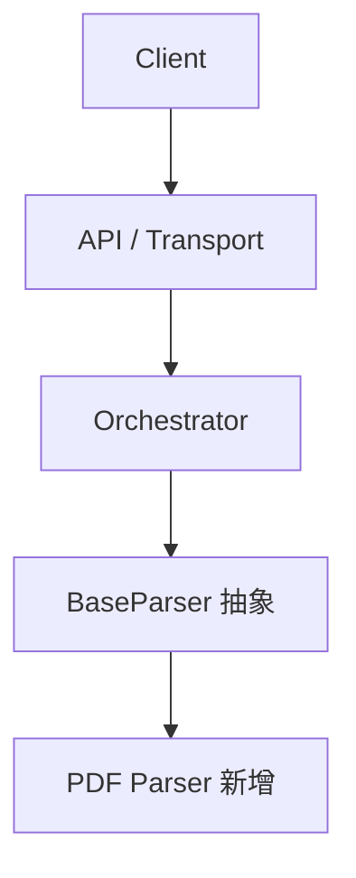

# 第 3 章：架构设计与核心方案

目标：回答**本次变更**怎么做。全局结构引用已批准的架构文档，本章只写变更范围内的拓扑、数据流与选型。

## 四个维度

1. **与全局架构的关系**：指向 `depends_on` 中的架构文档（通常是 `docs/architecture/` 下的 `type: architecture` 文件）；说明本次变更落在哪个模块。
2. **本次变更的拓扑与组件划分**：一张图（Mermaid C4/组件图），只画新增、改造的链路；标注新增、改造、保持不变。
3. **关键数据流与时序**：本次变更链路怎么走；异常时的兜底流向。
4. **关键技术决策**：为什么选这个协议/存储/并发模型；详细对比放第 7 章。

## 模板

```markdown
## 3. 架构设计与核心方案

### 3.1 总体架构

全局结构见 `docs/architecture/system.md`（Approved）；本次只改 Parser 算子层与 Pipeline 的调度入口。

本次变更的拓扑：



> 核心原则：职责单一，解析算子与持久化存储解耦。

### 3.2 核心模块职责

* **API / Transport**：连接、鉴权、请求入口（不变）。
* **Pipeline / Orchestrator**：新增 Checkpoint 调度（改造）。
* **Parser 算子层**：统一接口，插件化实现（改造）。
* **Storage Backend**：仓储模式，透明切换（不变）。

### 3.3 核心数据流转

1. 客户端提交任务，API 生成 Trace ID 并入队。
2. Pipeline 拉取任务，加载对应 Parser。
3. 每个关键节点写入 Checkpoint。
4. 结构化 `Document` 经 Storage 落库。

### 3.4 关键选型与约束

PDF Parser 先做同步解析：当前单文件上限 1 MiB，异步队列留到 Phase 2；详细对比见第 7 章。
```

## 避坑

- 不要复制架构文档里的全局拓扑、模块职责和历史决策；用路径或章节引用即可。
- 只有仓库里没有可引用的架构文档时，才在本章写全局拓扑，并说明它就是当前 SSOT。
- 不要在这里贴几百行类代码或 SQL；细节留第 4 章。
- 重点写"变与不变"：新引入什么、复用什么、哪些旧模块会受影响。
- 图里不写 Spec 编号。

## 检查

- 引用了 `depends_on` 中的架构文档，或说明为什么没有可引用的文档。
- 有一张能看懂的**本次变更**拓扑图。
- 每个模块有一句职责，不是目录清单。
- 写清了新增/改造/不变。
- 没有重复架构文档的全局结构。
- 关键选型有理由，详细对比指向第 7 章。
